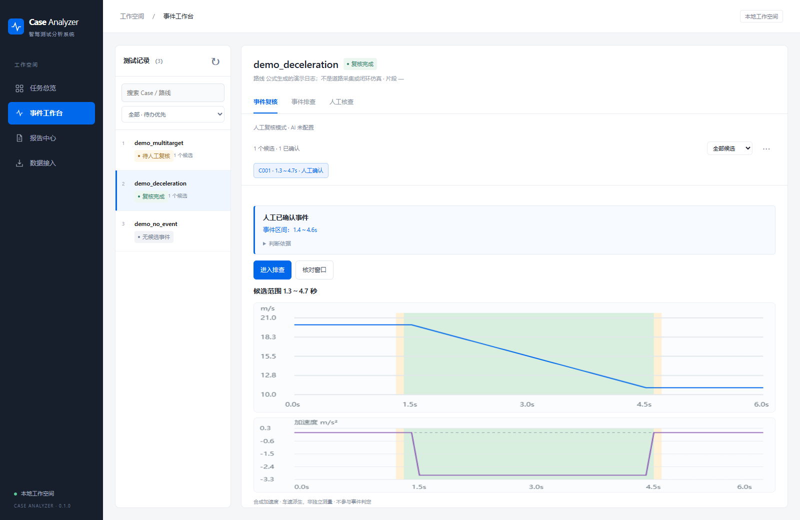
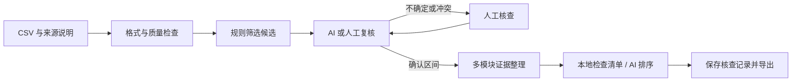

# Case Analyzer

**面向智能驾驶测试日志的事件复核与排查工作台。**

把 CSV 日志变成可检查、可追溯、可交付的 Case：规则筛选减速候选，AI 或人工完成事件复核，再结合车辆、目标、规划和控制证据生成初步排查报告。

`Python 3.11+` · `原生 JavaScript` · `本地单人运行` · `MIT`



*截图使用仓库内公式生成的演示数据。*

[快速开始](#快速开始) · [体验样例](#体验样例) · [数据格式](docs/DATA_FORMAT.md) · [工作原理](docs/ARCHITECTURE.md) · [参与开发](CONTRIBUTING.md)

## 为什么做这个项目

测试日志中的一次车速下降，往往需要经历“找到片段 → 确认事件 → 对齐各模块日志 → 整理证据 → 提出检查方向”。这些步骤容易反复切换文件，也容易把观测现象直接当作故障原因。

Case Analyzer 把这条流程放到同一个工作台中：保留原始引用，明确证据缺口，让模型在受约束的范围内参与复核和检查排序，让人工处理冲突与不确定结果。

## 能做什么

| 能力 | 具体行为 |
|---|---|
| 数据接入 | 校验 CSV、时间和车速，记录来源与导入哈希，拒绝覆盖同名 Case |
| 候选与复核 | 规则筛选候选；AI 可用时进入复核队列，不确定或不合规结果转人工 |
| 证据查看 | 查看车速、加速度及模块信号，定位原始 CSV 行；说明缺失与匹配歧义 |
| 初步排查 | 整理规划原因、目标变化、请求与响应；给出检查步骤、待补材料和判断分支 |
| 记录与恢复 | 保存人工确认、检查状态和备注；处理版本冲突、输入变化及任务中断 |
| 报告交付 | 导出 Markdown、JSON 和可离线打开的 HTML 报告包 |

**不配置 API Key 也能完成导入、人工确认、本地排查和报告导出。**

## 快速开始

克隆或下载本仓库，在仓库根目录执行。需要 Python 3.11 或更新版本，首次安装依赖需要联网。

### Windows

```powershell
.\setup.cmd
.\start.cmd
```

也可以依次双击 `setup.cmd` 和 `start.cmd`。安装脚本会创建本目录专用的 `.venv`，启动脚本优先使用该环境。

### Linux / macOS

```bash
python3 -m venv .venv
.venv/bin/python -m pip install -r requirements.txt
.venv/bin/python -m app
```

浏览器打开 **http://127.0.0.1:8770/**。首次启动是空工作空间，数据保存在自动创建的 `runtime/` 中。按 `Ctrl+C` 停止，重启保留已经保存的记录。

端口占用时加 `--port 8771`；不自动打开浏览器时加 `--no-open`；使用另一份数据目录时加 `--runtime <目录>`。

有有效模型配置时，导入后后台自动复核候选，并为确认事件生成排查报告，无需打开 Case 或点击启动。未配置模型时使用人工模式；需要主动关闭自动处理时加 `--no-auto-review`。

“数据接入”默认支持选择一个包含多条 Case 的目录，按子目录分别校验和导入；相同内容跳过，编号冲突不覆盖，失败条目可单独重试。目录结构与操作见 [批量接入与自动流程](docs/WORKFLOW.md)。

### 命令行批量导入

整批日志不必守在浏览器前：在仓库根目录执行

```shell
.venv/Scripts/python -m app import <日志目录> --source-type recorded --source-name "西安道路测试 · 第一批"
```

每个子目录按一条 Case 处理，至少包含 `vehicle_state.csv`。逐 Case 输出状态与行数，最后给出汇总；缺文件、编号非法或超过单 Case 大小上限都只报告该 Case，不中断整批：

```
seg_001    ready     可导入（vehicle 301 行 · object 301 行 · planning 301 行 · control 301 行）
seg_017    partial   可选日志缺失：object_state.csv；不影响导入
seg_042    error     Case 编号限 1～64 位字母、数字、下划线或短横线
------------------------------------------------------------
已导入 28 · 内容相同跳过 1 · 编号冲突 0 · 失败 1
```

命令行与“数据接入”页面调用同一套导入规则（内容相同跳过、冲突不覆盖、原子落盘），重复执行安全。`--dry-run` 只校验不写入；`--report <文件>` 把 JSON 汇总落盘，便于接入其他脚本；`--runtime <目录>` 指定数据目录；来源字段与页面一致，会写入每条 Case 的 `source_metadata.json`。导入不会自动触发复核，可在页面手动发起，或启动服务时按自动流程处理。

跑完想把结果推到群里：加 `--notify <飞书机器人 webhook>`（或设置环境变量 `FEISHU_WEBHOOK_URL`，命令行优先），完成后往群里的自定义机器人发一张汇总卡片（已导入/跳过/冲突/失败与失败明细）。webhook 地址不进仓库、不进报告；推送失败只在终端警告，不影响导入结果与退出码。

## 体验样例

仓库自带三个不依赖外部数据的合成样例：正常减速、多目标歧义、无减速事件。保持服务运行，在另一个终端执行：

```shell
python scripts/import_demo.py
```

然后：

1. 在任务总览打开 `demo_deceleration`，核对车速、加速度及候选区间。
2. 进入人工确认，核对整段数据和来源，保存事件区间，再保存候选与事件的关联结论。
3. 生成本地排查报告，查看证据、检查步骤和待补材料。
4. 保存检查备注，在报告中心导出离线报告包。

也可在“数据接入”选择整个 `examples/` 目录批量导入；单条导入时切换“单个 Case”，选择相应目录内的 CSV。详细操作和样例设计见 [演示指南](docs/DEMO.md) 与 [样例说明](examples/README.md)。

## 接入 AI（可选）

当前提供 DeepSeek 适配器。先复制配置模板，再在本机填写自己的 Key：

```powershell
Copy-Item configs/deepseek.example.json configs/deepseek.local.json
```

Linux / macOS 使用 `cp configs/deepseek.example.json configs/deepseek.local.json`。如果运行过 Windows 安装脚本，空白本地配置已经生成，直接编辑即可。

```json
{
  "api_key": "",
  "model": "deepseek-flash",
  "base_url": "https://api.deepseek.com",
  "reasoning_effort": "low",
  "max_tokens": 8192,
  "timeout_seconds": 180,
  "max_retries": 2
}
```

用当前 Python 环境运行 `python -m app --check-api` 检查连接，再重启工作台并去掉 `--no-auto-review`。Windows 可双击 `check-api.cmd` 检查、`start.cmd` 启动。连接检查本身会发出一次短请求。

也支持 `DEEPSEEK_API_KEY` 环境变量；本地配置中的非空 Key 优先。`deepseek.local.json` 已被 Git 忽略。启用模型后，当前步骤的日志片段或证据摘要会发送至所配置的服务，调用可能产生费用。参数说明见 [API 配置](docs/API_CONFIG.md)。

## 工作原理



- **规则**确定候选、数值口径和证据约束，数据质量不足时保留待核查状态。
- **AI**参与候选复核，并从已定义的检查项中选择排序；输出要经过结构、引用和区间校验。
- **人工**核对不确定结果，确认事件、执行检查并记录结果。模型不能替人工确认软件根因。

排查模型只接收程序计算的摘要和检查条件；完整证据留在本地。事实与具体操作由程序组装，模型不能改写为无证据的故障结论。详细数据流见 [架构说明](docs/ARCHITECTURE.md)。

## 评测结果（合成数据集）

在 30 段合成场景上按冻结评估协议端到端跑过一次完整流程（导入 → 规则筛选 → AI 复核 → 冻结批次 → 回放人工标签 → 开启对照出指标），`scripts/run_benchmark.py` 可复现，口径见 [评测方法](docs/EVALUATION.md)。

| 指标 | 数值 | 口径 |
|---|---|---|
| 候选覆盖率 | 27/27（100%） | 规则筛选窗口并集对人工标签事件的覆盖 |
| 自动确认 Precision | 26/26（100%） | AI 确认事件与人工标签 IoU≥0.5 一对一匹配；无误报 |
| 自动确认 Recall | 26/27（96.3%） | seg_030 未自动处理，原因见下 |
| 错误拒绝 | 0 | 没有把人工标签事件判成无事件 |
| 自动处理覆盖率 | 26/30（86.7%） | 30 个候选中 26 个 AI 自动处置，4 个按协议转人工 |

三点必须连同数字一起读：

- **数据是合成的**：30 段场景由公式生成（与 `examples/` 同款口径），非真实道路采集；数字证明流程闭环与口径自洽，不能外推为真实路测成绩。
- **标签来源**：构造真值 + 2026-10-15 人工逐段复核署名，**非盲标**；盲标复测需独立安排，且标签与预测严格分离（先冻结预测再回放标签）。
- 3 个 Case 未进入指标分母：seg_022/023 时间网格不连续未过数据质量门（协议不允许标事件结论），seg_024 人工结论为无法判断。

两个样本比全对更有信息量：

- **seg_011（0.998 m/s 边界样本）**：AI 判 `no_event`，与人工标签 negative 一致——边界样本上人与工具判断相同，这是整套数据里唯一被 AI 主动拒绝的候选。
- **seg_030（唯一未自动处理的事件）**：不是误报也不是漏报——事件贴片段边界，协议要求相邻片段确认边界，路由转人工（`segment_boundary`）。工具在这里选择保守，正是设计意图。

复现（需要本地模型配置，评测记录写入运行目录）：

```shell
python scripts/run_benchmark.py --dataset <Case 目录> --labels <标签目录> --runtime <运行目录> --reviewer <姓名>
```

同样支持 `--notify <飞书机器人 webhook>`（或环境变量 `FEISHU_WEBHOOK_URL`）：开启对照后把指标摘要（候选覆盖率、Precision、Recall、误拒绝、自动处理覆盖率）推送到群里；推送失败不中断、不影响退出码。

## 数据要求与使用范围

支持以下归一化 CSV。车辆日志必需，其他模块可以缺省，缺失会明确写入报告。

| 文件 | 主要内容 |
|---|---|
| `vehicle_state.csv` | 时间、车速，可附加加速度与制动反馈 |
| `object_state.csv` | 目标 ID、距离、相对速度、置信度 |
| `planning_state.csv` | 目标车速、规划加速度、决策原因 |
| `control_state.csv` | 制动/油门请求、请求加速度 |

时间使用秒，车速使用 m/s，车辆采样按当前规则要求为 0.1 秒。当前事件定义为项目自定的减速数值口径，具体阈值与合并条件见 [数据与事件约定](docs/DATA_FORMAT.md)。

减速事件可能属于正常驾驶行为。日志里的 `decision_reason`、近邻时间匹配、目标 ID 变化和 TTC 参考均需结合其他证据解释，不能单独证明故障原因。

当前定位为本地单人分析工具；未提供多用户鉴权或团队协作服务。仓库自带的合成数据集上已按冻结协议发布过一次端到端成绩（见 [评测结果](#评测结果合成数据集)），真实道路数据尚无独立成绩。评测时应使用独立标签与固定测试集，参考 [评测方法](docs/EVALUATION.md)。

## 开发与测试

```shell
python -m pip install -r requirements.txt
python -B -X utf8 -m unittest discover -s tests -v
python scripts/check_repo.py
```

默认测试使用临时目录、公式样例和模拟模型响应，无需 Key，不调用真实 API。覆盖导入、回滚、并发、人工确认、队列恢复、保存冲突、报告导出、事件匹配及排查约束。浏览器测试另行安装，见 [贡献指南](CONTRIBUTING.md)。

已配置 GitHub Actions 的 Windows / Ubuntu、Python 3.11 / 3.12 测试矩阵；实际执行状态以仓库 Actions 为准。

```text
case-analyzer/
├── app/          后端、复核队列、证据与报告
├── static/       HTML、CSS、JavaScript
├── configs/      规则与公开模型配置模板
├── knowledge/    排查知识目录与手册
├── examples/     可再生成的合成 CSV 样例
├── scripts/      样例导入、仓库检查、端到端评测与打包
├── tests/        自包含测试，无历史数据依赖
├── docs/         数据约定、架构、演示与评测方法
└── runtime/      本机运行时创建，Git 忽略
```

后续重点是独立数据评测、批量与长期运行验证、报告去重及更多日志格式适配。欢迎提交最小可复现问题与改进，详见 [CONTRIBUTING.md](CONTRIBUTING.md)。

维护者首次发布可参考 [GitHub 发布步骤](docs/PUBLISHING.md)。

## License

源码与随仓库提供的合成样例采用 [MIT License](LICENSE)。依赖库保留各自许可证；使用者自行导入的数据不属于本仓库发布内容。
