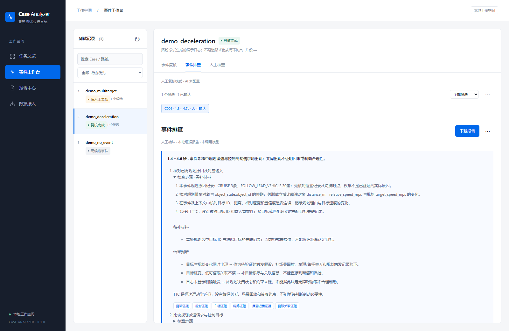
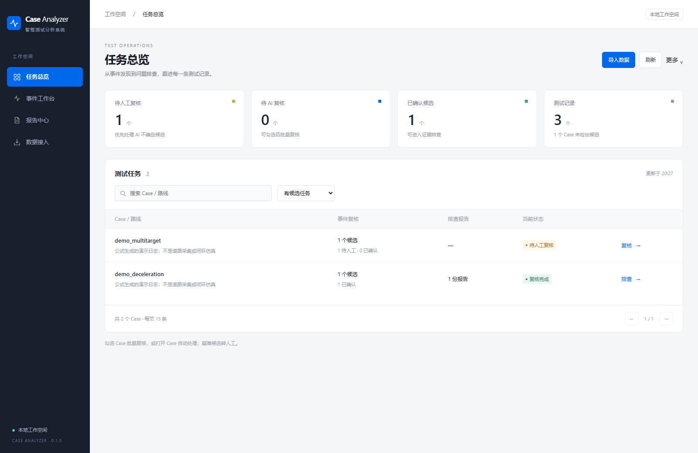

# 无密钥体验完整基础流程

先按照主 README 安装，以 `--no-auto-review` 启动。所有步骤都可以使用本地功能完成，不需要配置 API。

## 导入

在第二个终端运行 `python scripts/import_demo.py`，回到任务总览查看三个 demo Case。脚本通过现有导入 API 写入来源与哈希，已有同名 Case 会跳过。

页面导入时，选择批量目录模式并选中 `examples/`，或切换单个 Case、填写编号后选择目录内全部 CSV；来源选择合成数据，填写“公式生成的演示日志”。加速度来源填写“由演示车速有限差分得到”。

## 确认一个事件

打开 `demo_deceleration`：

1. 查看整段车速，再定位候选。演示公式在1.5～4.5秒下降，边界应以页面显示的固定事件口径和采样证据核对。
2. 切换人工确认，核对程序参考窗口。可以将参考区间加入草稿，也可编辑区间。
3. 填写标注者，勾选实际完成的整段、来源与边界核查，保存完整标注。
4. 回到候选处理，将结论设为确认事件，选择刚保存的事件，显式保存候选结论。

人工区间和候选关联是两条记录：保存前者不会自动替代后者。样例里的公式设计不构成独立人工真值；以上操作用于学习界面流程。

## 排查与交付

生成本地排查报告。规划/控制日志会出现减速与制动请求，但报告保留根因未知，并提出需要核查的目标关联、请求和车辆响应等检查。

展开检查步骤，填写一个核查状态及备注，点击保存。刷新后应能读取已保存内容。去报告中心选择有效报告并导出 ZIP，解压后打开 index.html，查看曲线、引用与保存的备注。

## 另外两个 Case

- `demo_multitarget`：同一时间出现两个目标。系统会说明歧义，并提出核查规划选中目标的关联，不能把它当成“没有目标”。
- `demo_no_event`：车速保持不变，应正常显示无减速候选。没有报告是该样例的正常结果。

重新开始时可用另一份 `--runtime` 目录。不要为重做样例删除实际工作记录。
