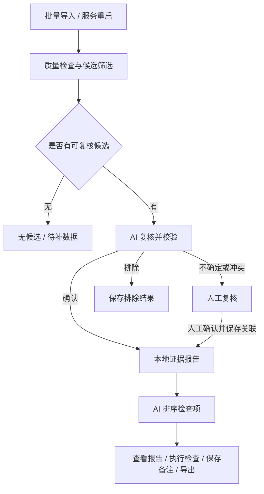

# 批量接入与自动流程

## 启动

在仓库根目录运行 `start.cmd`。模型配置填写在 `configs/deepseek.local.json`，检查连接后重启服务。正常启动会启用后台处理；加上 `--no-auto-review` 或关闭工作空间配置的 `automatic_review` 会停用自动处理。没有有效模型配置时进入人工模式。

## 导入一批 Case

在“数据接入”保持“批量目录”，选择以下示例中的 `new_batch`：

```text
new_batch/
  case_001/
    vehicle_state.csv
    object_state.csv
    planning_state.csv
    control_state.csv
  case_002/
    vehicle_state.csv
```

每个含受支持 CSV 的目录独立组成一条 Case，默认使用末级目录名作为编号。编号需为 1～64 位字母、数字、下划线或短横线，并以字母或数字开头。预览中可以修改编号；不同路径的同名目录需要改为不同编号。缺少车辆文件会拒绝该条，缺少其他模块允许导入并保留证据缺口。

选择本批数据的来源类型，可填写共同批次名和加速度来源，点击“校验并导入”。如果不同 Case 的来源声明不同，请分批导入。标注 JSON、排查答案、图片等非支持文件自动忽略，不会读入业务分析。车辆等受支持 CSV 的额外列会保存在原始文件中，分析仅使用支持字段。

系统先逐条校验，再逐条保存，每次只读取一条 Case。单条总计最多 24 MB，不对整批发出一个超大请求。已有编号且 CSV 字节及来源说明相同则跳过；内容、来源或编号大小写冲突时要求修改编号，不覆盖旧数据。一条失败不阻塞其他 Case。“重试失败项”只重试失败条目；文件内容需要修改时，修改后重新选择目录，相同的成功条目会跳过。

目录选择和文件读取由当前页面完成，上传时请保持页面打开。**导入成功后的模型分析由服务后台运行，页面可以关闭。** 关闭服务会停止后台；重启后扫描导入索引并恢复任务。

## 后台处理



队列串行处理，确认结果和报告分别保存。报告界面默认显示现象、关键证据缺口、优先操作和依据；其他检查及完整步骤折叠，证据引用、判断分支和完整导出继续保留。建议是排查顺序，不是已确认的模块故障。

任务总览可查看阶段、暂停和重试。已校验成功的结果复用；排查失败时保留本地证据报告，重试只补做失败步骤。超时或输出不合规不会静默无限重跑。401/402/403 会暂停后续队列，检查密钥、余额或访问权限后重试失败项并继续队列。中断时若不能确认服务商请求是否完成，需明确点击重试，不能保证重试不产生第二次计费。

只要启用有效模型配置，启动时也会处理已导入的待办 Case，可能调用真实 API。评估空间的模型结果保持冻结，不启用日常自动队列。输入或规则变化后，旧结果按指纹失效，重新分析可能产生新调用。
