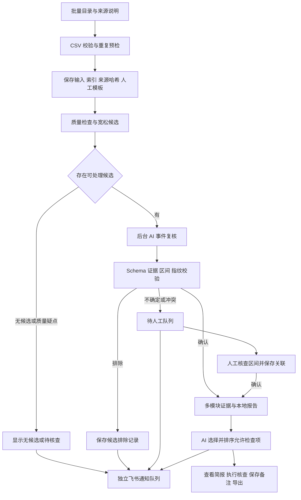
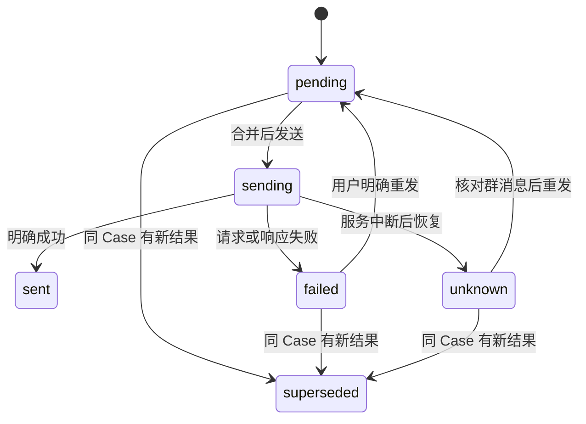

# Case Analyzer：项目复盘

依据：本次项目对话、当前开源工作目录代码及项目文档。整理日期：2026-10-17。

这是面试学习材料。文中“已实现”指当前代码能力；测试结果引用最近一次验证记录；历史业务数字单独注明来源。实际项目起止时间、本人逐项贡献和真实使用次数，应按自己的记录填写。

配套材料：[面试问答与讲稿](INTERVIEW_PREP.md) · [面试前速查](QUICK_REFERENCE.md)。

## 1. 用一句话讲清项目

Case Analyzer 是一个面向智驾测试日志的本地工作台：用规则筛选减速候选，用受约束的大模型复核事件和选择排查检查项，让人工处理疑点，并完成证据查看、记录保存、报告导出和飞书提醒。

它处理的是测试分析流程。事件定义、模型行为、证据来源、人工确认、评测结果都有各自的边界。

| 项目项 | 当前事实 |
|---|---|
| 服务对象 | 分析归一化智驾日志的测试人员；当前定位为本地单人使用 |
| 输入 | 车辆、目标、规划、控制 CSV；来源类型、批次名、加速度来源说明 |
| 核心事件 | 项目自定义的“持续明显纵向减速事件” |
| 输出 | 候选及确认区间、待人工原因、证据、检查清单、核查记录、离线报告和通知 |
| 主要技术 | Python、Pandas、NumPy、JSON Schema、DeepSeek 适配器、原生 JavaScript、本地文件与 SQLite |
| 启动方式 | `python -m app`，默认本机 8770 端口；路径基于项目目录解析 |
| 运行边界 | 不是车辆实时控制系统；没有团队多用户鉴权；输入需要先归一化 |
| 效果边界 | 减速现象可能正常；建议需要执行核查，不能直接认定软件根因 |

## 2. 与 Momenta JD 的对应关系

目标岗位是“AI 测试提效实习生”。岗位强调用 Python 和大模型处理测试中的重复工作，并建设可评价、可推广的工具。

| JD 工作 | 项目中的对应实现 | 面试时可展示的证据 |
|---|---|---|
| AI 辅助测试问题分析 | 事件复核、多模块证据整理、排查项排序 | 一个 Case 的输入、复核结果、证据引用、检查步骤 |
| Python 自动化脚本 | CLI 批量导入、质量检查、后台队列、评测脚本 | 导入预检、单条失败不中断、任务恢复 |
| 大模型 API 与 Prompt | 分阶段 Prompt、结构化输出、本地校验、调用记录 | `build_decision_prompt`、`validate_decision`、调用异常路径 |
| 飞书机器人 | 处理进展、待人工与失败通知 | 合并卡片、签名、去重、送达未知和显式重发 |
| 测试数据与评测 | 冻结预测、参考标签、IoU 匹配和分层指标 | 评测协议、失败样本及分母说明 |
| 排查手册、checklist | 本地知识目录、检查步骤、判断分支、待补材料 | 一条“依据—操作—分支—记录”的完整检查项 |
| 工具推广与使用支持 | 一键启动、无密钥演示、简洁页面、离线报告、开源说明 | 从空运行目录走一遍演示 |

项目目前没有实现独立的 AI Skill 包，也没有大型团队生产落地记录。可以讲清工具能力与岗位任务的对应关系，不必把 JD 的每个名词都写成已完成成果。

## 3. 从对话中提炼出的演进路线

以下按需求变化归纳阶段，不虚构每个阶段的日期或耗时。

| 阶段 | 当时的问题 | 做出的取舍 | 当前留下的能力 |
|---|---|---|---|
| 明确事件和标注口径 | 速度下降的一小段到底算不算事件，候选和事件混在一起 | 先定义数值事件，再讨论驾驶原因；完整事件由合格窗口合并产生 | 严格事件口径、宽松候选、参考窗口和区间 |
| 人工工作台 | 草稿保存过于频繁，页面说明过多，标注操作费力 | 区分草稿与正式保存，减少重复说明，保留必要核对项 | 可视化、人工区间、来源核对、候选关联 |
| AI 参与复核 | AI 只提意见，仍要逐个手动启动 | AI 给出可执行决策；程序校验和路由；不确定交人工 | 自动确认、自动排除、人工分流 |
| 明确阶段证据 | 规划、目标和 TTC 是否应参与“有无减速事件”的判断 | 事件复核主要看车速、加速度及来源；原因线索留给排查 | 两阶段输入边界，减少无关证据干扰 |
| 自动分析流程 | 导入后还要打开 Case、点击复核和生成报告 | 导入/启动发现待办，后台处理；成功结果作为检查点 | 持久队列、暂停、恢复、分阶段重试 |
| 骨架与数据分开 | 有效数据不足，流程修改和数据实验混在一起 | 工作台应能在空目录启动、使用公开样例演示；业务效果另评 | 独立运行目录、配置模板、自包含测试 |
| 报告贴近业务 | 建议冗长，不清楚先看什么、缺什么 | 默认显示现象、关键缺口、优先操作和依据，详细步骤折叠 | 简报、完整证据、核查记录、离线交付 |
| 开源整理 | 私有数据、配置和运行产物不适合公开 | 公共源代码与运行时分离，打包使用白名单 | 安装、README、样例、检查脚本和发布包 |
| 近期复核修复 | 导入异常中断、AI 自由解读、指标计错等 | 逐条隔离；正式说明受控；按保存状态统计 | 导入容错、证据绑定、评测失败保留 |
| 飞书完善 | 命令行有通知，网页自动流程没有提醒 | 独立通知线程，持久记录，短时合并，失败显式重发 | 日常进展通知、待人工提醒、重启去重 |

这段历史最值得讲的是：工具从“能分析一个样例”，逐步变成“能解释每一步状态、处理失败并交付结果”的系统。迭代由具体使用问题推动。

## 4. 一条数据的完整流转

图中的通知是自动处理阶段的状态更新，不是每次点击或保存备注都发通知；当前触发细节见 [飞书说明](../FEISHU.md)。

### 4.1 数据接入

车辆文件必需，其他模块可缺省。`object_state.csv` 表示目标状态的简化输出，不能等同于完整感知系统、原始图像、点云或已验证的目标关联真值。

| 文件 | 关键字段 | 主要用途 |
|---|---|---|
| `vehicle_state.csv` | `timestamp`、`speed_mps`，可选加速度、制动反馈 | 事件检测、辅助证据和车辆响应 |
| `object_state.csv` | 目标 ID、距离、相对速度、置信度 | 目标变化、缺口、TTC 和关联疑点 |
| `planning_state.csv` | 目标车速、规划加速度、决策原因 | 核对规划请求与日志自述原因 |
| `control_state.csv` | 制动、油门、请求加速度 | 核对控制请求与规划/车辆响应 |

时间为秒，速度为 m/s，当前车辆规则要求连续 0.1 秒网格。CSV 为 UTF-8；一条 Case 合计最多 24 MB，每份 CSV 最多 200000 行。额外列可以保留，但不会因此自动成为模型可用证据。

格式不合法与质量不足分开处理：无效车速、车辆时间重复等拒绝导入；可查看但采样有缺口的数据，可以保留并阻止自动确认。可选模块缺失需要显式写入排查限制，不能补成 0。

页面按受支持 CSV 所在目录分组；CLI 处理单 Case 或根目录直接子目录，不宜声称支持任意深度的目录自动发现。

### 4.2 三种“区间”必须分清

1. **宽松候选区间**：尽可能找出值得看的区域，不是最终事件。
2. **严格数值参考区间**：程序依项目事件协议计算，未经过人工独立核查时是参考。
3. **最终保存的处理结果**：经过程序约束的 AI 确认，或人工正式保存并关联的事件；人工参考标签另行用于评测。

一条 Case 不固定取几个窗口。长度为 N 个采样点时，六点滑窗通常共有 `N-5` 个，再按质量和阈值判断。多个窗口可以对应同一个完整事件，一个 Case 也可能有零个、一个或多个事件。

### 4.3 当前数值规则

| 条件 | 宽松候选 | 严格事件 |
|---|---|---|
| 窗口时长 | 0.5 秒 | 0.5 秒 |
| 对应采样点 | 6 点、5 个间隔 | 6 点、5 个间隔 |
| 首尾降速 | 至少 0.6 m/s | 至少 1.0 m/s |
| 下降间隔数 | 至少 3 个 | 至少 4 个 |
| 单个下降间隔门槛 | 沿用下降判断，至少约 0.01 m/s | 至少 0.01 m/s |
| 累计回升 | 不超过 0.2 m/s | 不超过 0.1 m/s |
| 浮点比较容差 | 按实现使用 | `1e-6` |

例如 0.0～0.5 秒的速度为 `[20.0, 19.8, 19.6, 19.4, 19.2, 19.0]`：降速 1.0 m/s、5 个下降间隔、累计回升为 0，满足严格数值窗口。平均加速度是 `-1.0/0.5 = -2.0 m/s²`，这只是该窗口的平均变化，不证明制动是否合理。

相交或相接的合格窗口取并集。分离窗口只有在间隔不超过 0.5 秒、间隙采样完整且速度无回升、端点仍下降至少 0.01 m/s 等条件成立时才桥接；不能仅因两个区间时间接近就合并。事件持续时间是 `end-start`，不能再加一个采样周期。

对应实现：[窗口计算](../../app/annotation_assist.py)、[合并规则](../../app/annotation_protocol.py)、[严格配置](../../configs/annotation_protocol_v1.json)、[桥接配置](../../configs/annotation_protocol_v1_1.json)、[候选配置](../../configs/candidate_screening.json)。

这些是项目自定义阈值，未依据量产道路数据完成标定。面试中可以解释设计意图和边界，不能称为行业标准或最优参数。

## 5. AI 的两项工作与约束

### 5.1 事件复核：判断当前候选怎么处置

模型接收当前候选的车速、加速度、上下文、六点窗口、严格参考区间、来源/连续性证据及规则。当前有效事件路径剥离了规划、控制和目标模块的原因证据。

模型给出三类决策：`confirmed_event`、`no_event`、`needs_human`。正式分流还要经过程序门槛：

- 来源/连续性通过且不需要相邻片段确认边界。
- 输出结构有效，证据编号和固定事实符合 schema。
- 引用完整的窗口、参考区间和来源证据，当前检查包括 E002、E003、E004。
- 确认区间完整对应严格参考区间，不能任意延长、缩短、增加或漏掉。
- 只有未达到数值条件且没有严格参考事件，才允许自动排除当前候选。

来源疑点、边界、模型不确定、缺引用或与数值冲突都不能直接确认。调用失败保留待 AI/待重试；结构不合规通常转人工。`review.status=validated` 表示输出通过校验，仍需看 `disposition` 才知道业务结论。

**关键反思：当前模型不是独立发现事件的算法。** 它获得了程序参考区间，并且不能自动改写这些区间。现阶段价值主要是受约束复核、疑点表达和工作流分流；是否优于规则直接执行，必须通过同口径消融验证。

### 5.2 加速度和 TTC 的边界

加速度给 AI 和人工辅助理解，但不新增事件门槛。由车速差分得到的加速度和原车速来自同一信息源，不能当作第二个独立传感器证明。缺失加速度也不能直接否定车速证据充分的事件。

TTC 是原因/风险线索，放在排查阶段。若相对速度负数表示接近，条件满足时可参考 `distance/(-relative_speed)`；距离、速度、目标关联和时间对齐均有前提。一次 TTC 小不代表规划故障，一次 TTC 大也不能排除已满足定义的减速现象。

### 5.3 排查：整理证据并选择下一步检查

只分析已确认事件。先由程序形成完整本地证据，再生成检查项，包括所需字段、时段、有效/缺失/歧义采样、核对动作、判断分支及待补材料。

发给模型的是程序计算的摘要、时间线和允许检查条件；完整原始行、逐点对齐和引用保存在本地。模型主要选择检查 ID 和排序，当前最多选择三项，必须保留优先的数据缺口检查。时间线说明 `finding_notes` 绑定到特定 `finding_index`，允许文本由程序给定并逐字段验证。

固定事实和操作由程序组装；schema 中的 `const` 和本地校验限制模型改写。事件复核中的部分自由建议仍有表达层风险，简单禁用词检查不等于完整语义证明，不能说系统已经消除了所有幻觉。

## 6. 多模块证据为什么难

多模块时钟、采样率和缺失情况不一定一致。当前按车辆事件采样点做有容差的近邻匹配，相关配置容差为 0.15 秒；用排序时间和二分查找选近邻，返回偏差与歧义。

| 观测状态 | 正确解读 | 错误解读 |
|---|---|---|
| 未匹配到记录 | 该时点证据缺失 | 模块没有发请求 |
| 字段为 null | 该字段未知 | 请求为 0 |
| 同时多个目标 | 目标关联存在歧义，需要选中目标信息 | 道路上没有目标 |
| 目标 ID 改变 | 日志 ID 发生变化 | 物理对象一定更换 |
| `decision_reason` 变化 | 规划日志自述原因变化 | 已找到真实故障原因 |
| 时间差在容差内 | 当前规则下可比较 | 已校准时钟，可直接计算执行延迟 |

程序统计的是覆盖情况、阈值观测和检查条件。即使规划减速请求与控制制动在同一区间出现，也不能单凭“出现过”推出完整时序因果链。真实模块归因还需要时间同步、选中目标、完整请求传递、执行反馈、版本和复现实验。

本地知识检索是目录中的结构状态匹配加关键词评分，默认取少量相关手册；没有 embedding、向量库或已训练的语义检索模型。可以称为轻量知识检索与检查清单，不宜包装成复杂 RAG 平台。

## 7. 保存、并发与恢复

### 7.1 输入不能默默被覆盖

导入前校验字段、大小、编号和冲突。相同编号、相同文件内容与来源可以跳过；内容或来源变化、大小写冲突需要换编号。来源元数据和导入清单记录哈希。

导入使用 staging 目录，写入输入、标注模板、来源登记后更新索引；普通异常回滚本次创建的文件。单文件用临时文件替换降低半写入风险。这是多文件提交与补偿，不是数据库跨多文件 ACID 事务，不能保证所有断电时点均恢复。

### 7.2 三类状态分开存

| 状态 | 大致存储 | 为什么分开 |
|---|---|---|
| 原始数据、来源与索引 | `runtime/data`、`runtime/index` | 保留输入和来源依据 |
| 人工标注 | `runtime/annotations` | 人工事实不被 AI 结果覆盖 |
| AI 复核、队列、排查及核查记录 | `runtime/model_reviews` | 处理结果、进度及操作留痕 |
| 冻结评测 | `runtime/evaluations` | 固定预测、标签、规则与对照 |
| 飞书记录 | model_reviews 下 SQLite 文件 | 支持通知去重、恢复和状态更新 |

人工“事件区间”与“候选关联决策”也是两条记录。一个候选可能包含多个事件，完整事件可能跨出候选边缘；保存标注后还要明确关联，不能用“这个 Case 标过了”代替每个候选的处置。

### 7.3 指纹解决什么

复核指纹覆盖车辆、来源、规则、候选及上下文配置等依赖；请求前核对，返回后再次核对。输入变化时旧结果标为 `stale`，不当作当前结果使用。排查有自己的模块与规则依赖。

事件复核只依赖它实际用到的车辆和来源信息，因此规划日志变化不应无谓重跑事件复核，但相关排查必须失效。哈希保证的是“是否与当时的文件一致”，不能证明数据是真实道路采集。

人工保存通过 expected revision 等字段检查是否持有当前版本，多页面旧记录不能直接覆盖新结果。这属于乐观并发控制。

### 7.4 后台队列

自动队列是单 worker、串行模型处理，状态包括 `queued/running/complete/failed/changed`，另有 review、investigation、done 等阶段。HTTP 服务可并发响应，但不等于并行调用大量模型。

模型请求前先落盘任务与 in-flight 状态，成功复核和成功报告分别作为检查点。排查失败时保留本地证据；重试补失败阶段。认证、余额或权限状态 401/402/403 会暂停后续队列。

SDK 隐式重试关闭，适配器对特定临时错误做有限重试并记录次数；任务层对结果未知的中断请求要求明确重试。这两层策略必须分清。网络超时或进程中断不能证明服务商没有处理请求，不能保证重试零重复计费。

进程内锁处理同进程并发，工作空间/队列文件锁限制重复服务持有者。CLI 与服务共享目录的跨进程导入竞争仍需专门审计，不宜声称所有入口都已具备数据库级并发隔离。

## 8. 飞书功能的工程取舍

日常自动任务在终态生成精简通知记录，独立线程执行远程请求。模型队列需要做本地读取和落盘，但不等待飞书网络往返。

默认首条记录等待 5 秒，与期间更新合并，每条最多 20 个 Case。去重键结合任务身份、输入及结果内容，并持久保留已发记录；相同任务恢复不应刷屏，新任务或新结果可产生新通知。

`unknown` 解决“远端可能已接收，但本地没来得及记录成功”的窗口。Webhook 没有被本系统控制的端到端事务，因此只能提供明确状态和用户决策，不能承诺 exactly-once。

支持本地私有配置、关键词和签名。卡片包含编号、状态、计数和链接，不放原始 CSV 或完整报告；本机 127.0.0.1 链接只在服务电脑上有效。飞书目前是通知入口，不能在群内完成事件复核。

最近验证使用模拟发送和无头浏览器，没有据此声称真实群已接通。

## 9. 评测到底评价什么

### 9.1 四层评价

| 层次 | 要回答的问题 | 当前证据 |
|---|---|---|
| 功能正确性 | 导入、保存、分流、恢复是否按预期工作 | 最近记录 107 项自动化测试通过，另有飞书浏览器验收 |
| 事件业务效果 | 候选是否覆盖、确认是否准确、多少要人工 | 评测脚本和协议；历史小规模合成回归数字 |
| 排查建议质量 | 事实对不对、步骤能否执行、有无无依据结论 | 有报告评价接口；当前事件脚本不评这一项 |
| 实际提效 | 是否节省时间、增加成本是否合理 | 尚缺可公开复核的真实工作计时与对照结果 |

107 是测试用例数量，不是覆盖率、准确率、真实模型成功率或性能指标。对话中使用过合成数据，并有用户声明来自闭环仿真的数据尝试；当前不能仅凭这些描述推导新的真实道路效果数字。

### 9.2 标签的作用

人工标签用于定义和检验目标，发现候选漏筛、自动误判和边界错误。AI 自动结果、程序参考和人工评测标签不能混为一份。

人工标签至少记录整段核对结论（positive/negative/uncertain/data_issue）、完整事件区间、核查人、口径和来源。排查标签应另标事实、可执行性、无无依据结论，以及允许据证据确认的内容；不能把所有疑点都标成确定模块故障。

开发早期可以少量人工复核校准口径；正式计算固定测试集指标时，应完成该评测范围内所需参考标签，未完成项明确排除或停止评测，不能混用未审核的模型标签充当独立真值。

### 9.3 冻结流程

事件评测脚本要求新运行目录，检查完整导入和标签文件一一对应。模型生成结果后先冻结预测、输入文件和规则等资源，再回放标签、开启对照。标签文件名检查发生在模型调用前，但标签结论回放发生在冻结之后。

该流程减少标签与预测互相覆盖，不能把已经看过标签调过参数的数据变成独立测试集，也不能把“回放标签”说成已经实现独立盲标。

### 9.4 指标与分母

| 指标 | 当前口径 |
|---|---|
| 候选覆盖率 | 对每个真值事件计算候选区间并集覆盖比例，达到 0.9 算覆盖；已覆盖事件数/真值事件数 |
| 自动确认 Precision | TP/(TP+FP)；AI 确认区间与真值事件 IoU≥0.5 一对一匹配 |
| 自动确认 Recall | TP/(TP+FN)；有效真值事件中没有自动确认匹配的仍为 FN |
| 自动处理覆盖率 | AI 确认或排除的候选数/全部冻结候选数；计数单位是候选 |
| 错误拒绝 | 被 AI 排除候选覆盖到的真值事件，按单独阈值统计 |
| 报告有用率 | 已完成审阅且各检查项通过的报告/已完成审阅报告；无审阅时未知 |

事件指标使用 positive/negative 的有效标签 Case；uncertain/data_issue 单独报告排除原因。自动处理覆盖率在实现中统计全部冻结候选，不应假定与事件指标分母相同。分母为零返回未知，不写成 0% 或 100%。

事件匹配使用最大数量的一对一匹配，重复预测不能重复领取 TP。边界转人工可以符合产品设计，但只要有效真值事件没有自动确认匹配，就降低自动 Recall；它是否候选漏筛另看候选覆盖率。

调用失败保留在预测和评测总体中；不能把失败候选剔除后宣称更高成绩。数据质量排除规则同样需要事先声明，并报告排除数量，避免评价只剩容易样本。

### 9.5 历史数字怎么使用

README 留有 30 段合成场景的维护者历史记录：候选覆盖 27/27、自动确认 Precision 26/26、Recall 26/27、自动处理覆盖 26/30。完整输入、标签和冻结产物未随仓库公开，本次没有重新验证这组数字。

可以把它当作理解统计口径的案例，面试主讲时优先说“已实现冻结评测和指标计算”。若要引用数字，必须同时说明：合成数据、小规模、构造真值经人工复核、非独立盲标、复现材料状态。真实道路和复杂仿真效果另行验证。

当前 `run_benchmark.py` 的快照 `reports={}`，输出明确 `evaluation_scope=event_review`、`report_quality.status=not_evaluated`。事件分数不能证明建议正确，建议指标也不能证明定位根因。

## 10. 五个可以讲透的真实问题

### 10.1 一个坏编码文件中断整批

**问题：** 原先读取 Case 文件发生在逐条异常隔离范围之外，无效 UTF-8 会让后续健康 Case 无法导入。

**处理：** 将读取和构造载荷放入逐 Case 的 try 内，编码错误转换为可理解的失败状态；缺可选模块改为当前 Case 的 warning，不再增加一条“partial Case”。失败汇总包括无效车辆文件。

**验证：** 坏文件在前、健康 Case 在后的测试验证整批继续；还覆盖文件读取失败、CRLF 内容保持和重复判断。

**可复用经验：** 隔离范围应覆盖真正会失败的 I/O，而不仅是后面的业务函数；统计单位必须固定。

### 10.2 JSON 合法仍能编造故障

**问题：** 旧版 finding_notes 只检查类型、非空和序号，像“已确定控制器故障，延迟 999 秒”这样的文本仍可能符合结构。

**处理：** 正式时间线说明限定为当前条目允许的文本，由程序填入观测和引用；模型选用，保存重放和渲染同样校验。

**验证：** 测试恶意 interpretation、verification、needed_data，以及把说明错配到另一 observation，都应拒绝。

**可复用经验：** Schema 约束的强度取决于字段定义；任意字符串依然是自由输出。收紧生成自由度会损失表达弹性，需要诚实解释收益和代价。

### 10.3 “函数返回”被当成“复核成功”

**问题：** review 函数可能正常返回一个保存了 call_failed 的 Case，评测旧逻辑仍累计成功；此外报告未评价却容易被描述成全业务成绩。

**处理：** 按返回记录中的 review.status 统计，通过校验与业务分流分开；失败保留，事件指标仍按协议计算；运行带失败状态并以非零退出码结束；报告质量显式未评测。

**可复用经验：** Python 没抛异常、模型 JSON 合法、事件判断正确、建议有用是四件不同的事。

### 10.4 通知异常影响主流程与密钥日志

**问题：** 非法地址在异常保护外构造请求，非对象 JSON 不能正常处理，异常或服务端原文可能回显含令牌的地址。

**处理：** 请求构造和解析纳入保护；检查响应大小、类型和状态码；保留脱敏错误类型/数值码；工作台使用独立线程和本地状态。

**验证：** 非法 URL、数组/null 响应、回显敏感地址和超时等使用模拟响应验证；不向真实群试发来跑回归。

### 10.5 交互便利不能破坏正式保存

**问题：** 对话里多次出现“草稿保存影响输入”“不知道在哪复核”“标注完了为什么还要关联”等使用困难。

**取舍：** 将草稿、正式标注、候选处置和核查记录显式分开；页面减少长说明，以当前状态和必要操作引导。复杂原因与步骤放在展开区域。

**经验：** 自动化的最后一环是用户能理解当前状态并完成下一步。界面简洁不等于把不同语义压成一个“已完成”。

## 11. 成果、局限与后续优先级

### 已有成果

- 空运行目录可启动，具有不依赖私有数据的公开样例和无密钥流程。
- 数据接入、质量控制、规则候选、AI/人工复核、证据排查、核查记录、离线交付串联。
- 有可解释的路由门槛、引用约束、输入变化失效、队列恢复和失败处理。
- 支持冻结事件评测、独立标签存储和报告评价入口。
- 飞书已实现配置、签名、合并、去重和显式重发；最近以模拟与浏览器验证。
- 最近一轮记录为 107 项自动化测试通过，另有飞书页面验收、仓库检查和发布包检查通过。

### 当前局限

- 模型不能独立改进自动事件边界，严格参考对其决策有强约束；AI 的边际收益未通过消融充分证明。
- 当前输入是固定格式和采样口径，不能直接覆盖原始 CAN、视频、ROS bag 或所有厂商日志。
- 证据关联是近邻与统计摘要，不能代替时钟同步、目标真值和因果实验。
- 真实道路、长期批量稳定性、工程师实际节时与成本收益缺少充分独立验证。
- 单机文件存储与锁有适用范围，未实现团队权限、分布式任务和端到端恰好一次。

### 后续优先级

1. 固定一批允许使用且来源可说明的独立数据，补齐事件标签、质量问题及必要上下文；保留开发/测试边界。
2. 对照规则直接处置、规则加 AI 复核、规则加 AI 加人工，分别看事件质量、人工负担、模型调用成本。
3. 对排查报告做独立工程审阅，记录事实、引用、可执行性和无无依据结论，别沿用事件分数。
4. 小样本对照测量人工分析时间、复核耗时和返工次数，同时记录 Token、失败率与延迟。
5. 有规模需求后再决定导入事务存储、跨进程锁、任务并行、鉴权与更多日志适配；按真实瓶颈增加组件。

## 12. 自己的贡献怎么复盘

项目经过 AI 辅助迭代，面试需准确说明工具参与范围。业务决策与技术理解不由生成了多少代码来替代。

| 需要核对的个人事项 | 可以用什么证明 |
|---|---|
| 我提出或确认了什么需求 | 对话中的事件定义、分阶段证据、自动复核、简报和飞书需求 |
| 我做过哪些核查 | 手工区间、错误标注修正、报告评价、工作台使用反馈 |
| 哪些模块我能解释并修改 | 当场讲输入、输出、函数、状态与失败路径，做一处小改动 |
| AI 帮了什么 | 代码草稿、调试、测试、文档；按实际说明 |
| 我尚未证明什么 | 独立业务成绩、量产部署、团队节时比例、完整根因定位 |

不建议背“全部独立从零手写”的说法。可以表述为“在 AI 辅助下迭代实现，我重点负责需求判断、事件口径、流程验收，并理解和维护这些具体模块”，后半句只填写自己确实能讲清的部分。

## 13. 核心代码阅读路线

按顺序读一条链路，比先记全部文件名有效。每读一个入口，回答：输入是什么、输出是什么、什么时候失败、谁消费这个输出。

| 顺序 | 文件 / 函数 | 需要讲清的内容 |
|---|---|---|
| 1 | [启动入口](../../app/__main__.py)：`make_context/main` | 运行目录、模型模式、服务租约、CLI 分派 |
| 2 | [接入](../../app/storage.py)：`inspect_import/import_case` | 校验、重复、staging、索引和回滚 |
| 3 | [窗口](../../app/annotation_assist.py)：`build_annotation_assist` | 六点窗、质量门、参考事件 |
| 4 | [候选](../../app/candidate_review.py)：`build_candidate_case` | 宽松区域与严格参考的关系 |
| 5 | [模型决策](../../app/candidate_decision.py) | Prompt、校验与最终路由 |
| 6 | [结果存储](../../app/workbench_reviews.py)：`review` | 请求前后指纹、状态和保存 |
| 7 | [人工关联](../../app/human_event_review.py)：`resolve_human` | 标注版本、事件选择与确认 |
| 8 | [自动队列](../../app/automatic_review.py) | 持久状态、检查点、失败和恢复 |
| 9 | [排查](../../app/event_investigation.py) | 近邻、覆盖、摘要、受控输出 |
| 10 | [检查项](../../app/investigation_actions.py)、[简报](../../app/investigation_summary.py) | 可执行步骤、分支和展示 |
| 11 | [评测](../../app/evaluation.py)、[脚本](../../scripts/run_benchmark.py) | 冻结、一对一匹配、分母与报告范围 |
| 12 | [飞书](../../app/workbench_notifications.py)、[传输](../../app/notify.py) | 独立线程、SQLite、合并、未知送达 |

建议挑三个测试边读边解释：[自动流程](../../tests/test_automatic_pipeline.py)、[排查约束](../../tests/test_investigation.py)、[通知恢复](../../tests/test_workbench_notifications.py)。先说输入和预期，再解释测试为什么能发现过去的错误。
